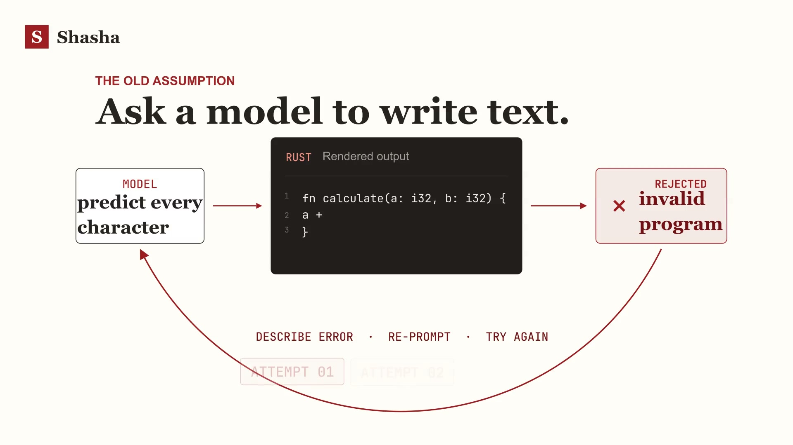

# Shasha

Shasha is a small research/demo project exploring structured Rust code generation. It contains two independent demos:

- **Guided examples UI:** a React interface with three authored, deterministic pathways that show how choices become readable Rust.
- **Structured generation prototype:** a Rust/Candle model that chooses typed actions, parameter pointers, and bounded identifier characters. A controller renders Rust and checks the result with `rustc`.

The UI does not call the Rust model. The model has random weights and has not learned to follow English requests.

## Explainer video

[](https://youtu.be/FegaRcG-3I4)

Click the preview to watch the explainer video on YouTube.

The explainer shows how constrained semantic actions are rendered into valid Rust.

## Quick start

### Guided examples UI

Requires Node.js and npm:

```sh
npm install
npm run dev
```

Open the local URL printed by Vite. For a production build, run `npm run build`; `npm run preview` serves the built app.

The UI offers three fixed pathways:

1. **Grow a calculator** — addition, multiplication, and checked arithmetic.
2. **Search a collection** — finding even numbers, collecting matches, and stable de-duplication.
3. **Handle boundaries** — clamping, validating bounds, and using an inclusive range.

Each step exposes function details beside the Rust. The Copy action copies that snippet to the clipboard. These examples are authored; they are not model inference.

### Rust generation prototype

Requires Cargo and `rustc` on `PATH`. The default build uses CPU:

```sh
cargo run -- "add two integers"
cargo test
```

The quoted command-line argument is the input message. `src/tokenizer.rs` maps each UTF-8 byte to an ID from 0 to 255, accepting at most 114 bytes to leave room for generated actions. The CLI shows token IDs, selected heads, actions, and rendered Rust. This lossless byte encoding is not a pretrained language tokenizer.

To request a device explicitly:

```sh
SHASHA_DEVICE=cpu cargo run -- "add two integers"
SHASHA_DEVICE=cuda cargo run --features cuda -- "add two integers"
```

`auto` (the default) selects CUDA if the binary has the feature and a device is available; otherwise it uses CPU. An explicit CUDA request fails if CUDA is unavailable. CUDA requires a supported NVIDIA driver, GPU, and toolkit with `nvcc` on `PATH`. On the RTX 5080 used for testing, `/usr/bin/nvcc` is CUDA 12.0 and too old for compute capability 12.0; the installed CUDA 13.0 toolkit works:

```sh
PATH=/usr/local/cuda/bin:/usr/bin:/bin CUDA_ROOT=/usr/local/cuda SHASHA_DEVICE=cuda cargo run --features cuda -- "add two integers"
```

The GPU was hidden inside the coding terminal sandbox; the CUDA run was verified outside it. A normal local terminal with GPU access does not need sandbox changes.

## How the Rust prototype works

```text
UTF-8 prompt bytes → causal transformer → controller-selected head
    → head-local action or live-symbol pointer → bounded naming
    → deterministic Rust rendering → rustc syntax/type check
```

- `src/model.rs` contains the tiny causal transformer, routed signature/expression/name-character heads, and a query/key pointer score over live parameter slots. Only the selected head runs.
- `src/controller.rs` chooses from zero, one, or two `i32` parameters; expressions include parameter references, wrapping addition/subtraction, and four equally available no-parameter actions: `0`, `1`, `1 + 1`, and `1 - 1`. The latter two are fixed templates, not generated operands or operators.
- The pointer uses stable symbol IDs (`@1` or `@2`), not identifier spelling. The naming heads emit up to three lowercase characters per symbol; the controller adds `n_` and a symbol-ID suffix to make names legal and distinct.
- `src/lib.rs` runs the inference loop; `src/validation.rs` runs `rustc` on every completed result before returning it. If syntax or type checking fails, generation returns an error rather than claiming valid Rust. No post-hoc action mask or task-specific override is used.

The weights are randomly initialized. All actions are selectable, but the model cannot reliably answer a prompt; equal availability does not imply equal random logits. A successful `rustc` check proves neither prompt adherence nor good logic. Tests check all structural branches, pointer-selected names, and a running addition example.

## Limits and next steps

The starter supports one expression per function, at most two parameters, and bounded lowercase names. It has no dataset, training, pretrained weights, checkpoint format, batching, or KV cache. Its pointer keys are learned by slot, not derived from arbitrary declarations, and the web UI is separate.

1. Train on paired prompt/action data (or evaluate a pretrained English backbone); define checkpoint-compatible action IDs.
2. Extend the controller and IR with more types, statements, calls, and declaration-state pointer keys.
3. Evaluate semantic correctness against a text-generation baseline at matched compute.
4. Connect the UI to a real inference service once its interface is stable.

## Project structure

```text
src/              Rust model, controller, tokenizer, validator, and tests
web/              React guided-examples interface
manim_animation/  Explainer video source and rendered media
slidev_slideshow/ Presentation source
index.html        Vite entry point
```
